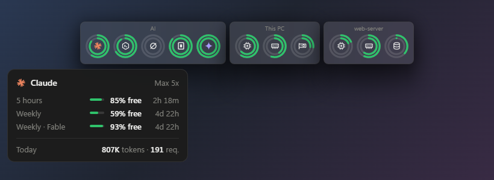
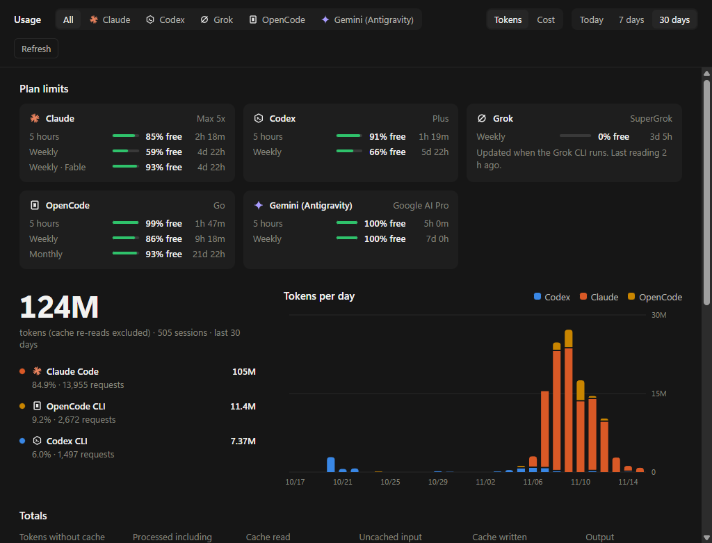

# NT Usage Tracker

**See how much of your AI coding plans is left, and how hard your PC and servers are working, without opening anything.**

[How to use](HOW-TO-USE.md) · [Download](https://github.com/ntweb-design/nt-usage-tracker/releases/latest) · [Português (Brasil)](README.pt-BR.md)



NT Usage Tracker is a small always-on-top widget for Windows. It shows the 5-hour and weekly limits of Claude Code, Codex, Grok, OpenCode and Gemini as rings, next to the load of your PC and of your VPS servers. It reads the sign-ins your CLIs already have, so there is nothing to set up for most providers. Hover a ring for the details, click it for a 30-day usage report.

## Why NT Usage Tracker

- **One glance instead of five dashboards.** Every plan you pay for, with its reset times, in one row of rings that is always on screen.
- **Nothing new to sign in to.** It reuses the sessions your CLIs already keep on this machine, read-only, and never refreshes or copies them.
- **Your servers too.** CPU, memory, disk and network of each VPS over plain SSH, with nothing installed on the server and no root needed.
- **Stays out of the way.** Small boxes you can drop anywhere, snap to edges, corners and to each other, and make transparent.

## Quick start

1. Download and run `NT-Usage-Tracker-Setup-<version>.exe` from the [latest release](https://github.com/ntweb-design/nt-usage-tracker/releases/latest). It installs for your user only. The installer is not signed, so SmartScreen asks once: **More info › Run anyway**.
2. The widget appears on the right edge of the screen. Providers whose CLI is installed show up by themselves.
3. Right-click a box for everything else: sign in to a CLI, add a VPS, change the language.

Or build it yourself:

```bash
npm install
npm start
npm run dist   # installer in dist/
```

## Features

| Feature | Notes |
|---|---|
| AI plan limits | Claude Code, Codex CLI, Grok CLI, OpenCode Go and Gemini (Antigravity): 5-hour, weekly and monthly windows with reset times. |
| Claude API spend | This month's real spend from Anthropic's usage API, against an optional budget. Needs an Admin key. |
| Usage report | Tokens, requests and estimated cost per day, per provider and per model, for up to 30 days. |
| This PC | CPU, memory and GPU load, from any GPU vendor. |
| VPS monitor | CPU, memory, disk, I/O, network and uptime over SSH. Works with your `~/.ssh/config`, ssh-agent and Tailscale. Can generate a key for you. |
| Free layout | Boxes go anywhere, snap to screen edges, corners and centre lines, and to any side of another box on an icon grid. Snaps glide into place. |
| Box names | A discreet label above each box ("AI", "This PC", your server's name), renamable. |
| Tray menu | Hide or show the widget, transparency, light or dark theme, language. |
| Languages | English and Brazilian Portuguese. |
| Private by design | Read-only access to your CLI sign-ins. The Claude API key is encrypted with Windows (DPAPI), and nothing personal lives in the program folder. |



## Learn more

[HOW-TO-USE.md](HOW-TO-USE.md) has the full guide:
- reading the rings;
- connecting each provider and the Claude API;
- adding a VPS and its key;
- arranging and snapping boxes;
- the menus;
- how cost is estimated;
- exactly what is stored where;
- troubleshooting;
- building from source.

## About this project

NT Usage Tracker started as a personal tool, built around the AI tools I use every day. That is why it covers these providers and not others, and why it is Windows only for now. I am sharing it as it is, in case it is useful to someone else.

**Contributions are welcome.** Open an issue or a pull request for a bug fix, a new feature, or support for another AI provider (each provider is one small file in `src/collect/`). I read and review every one.

## License

[MIT](LICENSE).
