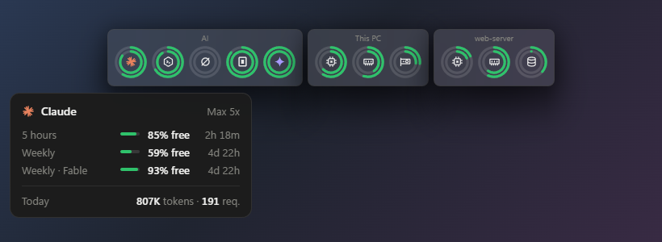
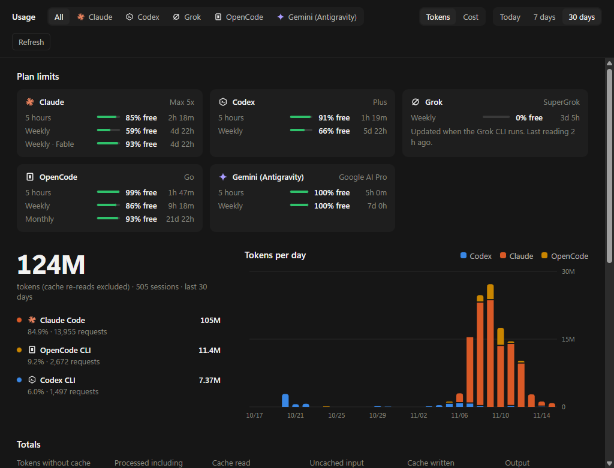

# NT Usage Tracker

**Veja quanto resta dos seus planos de IA para programação, e o quanto o seu PC e os seus servidores estão trabalhando, sem abrir nada.**

[Como usar](HOW-TO-USE.pt-BR.md) · [Baixar](https://github.com/ntweb-design/nt-usage-tracker/releases/latest) · [English](README.md)



O NT Usage Tracker é um pequeno widget para Windows que fica sempre por cima das outras janelas. Ele mostra, em anéis, os limites de 5 horas e semanais do Claude Code, Codex, Grok, OpenCode e Gemini, ao lado do uso do seu PC e das suas VPS. Ele lê os logins que os seus CLIs já têm, então na maioria dos providers não há nada para configurar. Passe o mouse num anel para ver os detalhes; clique para abrir um relatório de 30 dias.

## Por que usar

- **Uma olhada em vez de cinco painéis.** Todos os planos que você paga, com o tempo até zerar, numa fileira de anéis que fica sempre na tela.
- **Nenhum login novo.** Ele reaproveita as sessões que os seus CLIs já guardam nesta máquina, só para leitura, e nunca as renova nem copia.
- **Seus servidores também.** CPU, memória, disco e rede de cada VPS por SSH comum, sem instalar nada no servidor e sem precisar de root.
- **Não atrapalha.** Boxes pequenas que você solta em qualquer lugar, encaixa nas bordas, nos cantos e umas nas outras, e deixa transparentes.

## Início rápido

1. Baixe e rode o `NT-Usage-Tracker-Setup-<versão>.exe` da [última release](https://github.com/ntweb-design/nt-usage-tracker/releases/latest). Ele instala só para o seu usuário. O instalador não é assinado, então o SmartScreen pergunta uma vez: **Mais informações › Executar assim mesmo**.
2. O widget aparece na borda direita da tela. Os providers cujo CLI está instalado aparecem sozinhos.
3. O app abre em inglês. Para usar em português, clique com o botão direito numa box › **Language › Português (Brasil)**.
4. O resto também fica no botão direito: entrar num CLI, adicionar uma VPS, trocar a grade de encaixe.

Ou compile você mesmo:

```bash
npm install
npm start
npm run dist   # instalador em dist/
```

## Funcionalidades

| Funcionalidade | Detalhes |
|---|---|
| Limites dos planos de IA | Claude Code, Codex CLI, Grok CLI, OpenCode Go e Gemini (Antigravity): janelas de 5 horas, semanais e mensais, com o tempo até zerar. |
| Gasto na Claude API | O gasto real do mês pela API de uso da Anthropic, contra um orçamento opcional. Precisa de uma chave Admin. |
| Relatório de consumo | Tokens, requisições e custo estimado por dia, por provider e por modelo, em até 30 dias. |
| Este PC | Uso de CPU, memória e GPU, de qualquer fabricante. |
| Monitor de VPS | CPU, memória, disco, I/O, rede e tempo no ar por SSH. Funciona com o seu `~/.ssh/config`, o ssh-agent e o Tailscale. Pode gerar a chave para você. |
| Layout livre | As boxes ficam onde você quiser, encaixam nas bordas, nos cantos e nas linhas de centro da tela, e em qualquer lado de outra box numa grade de ícones. Os encaixes deslizam até o lugar. |
| Nomes das boxes | Um rótulo discreto acima de cada box ("IA", "Este PC", o nome do servidor), que dá para renomear. |
| Menu da bandeja | Esconder ou mostrar o widget, transparência, tema claro ou escuro, idioma. |
| Idiomas | Inglês e português do Brasil. |
| Privado por padrão | Acesso só de leitura aos logins dos CLIs. A chave da Claude API é criptografada pelo Windows (DPAPI), e nada pessoal fica na pasta do programa. |



## Saiba mais

O [HOW-TO-USE.pt-BR.md](HOW-TO-USE.pt-BR.md) tem o guia completo:
- como ler os anéis;
- como conectar cada provider e a Claude API;
- como adicionar uma VPS e a chave dela;
- como arrumar e encaixar as boxes;
- os menus;
- como o custo é estimado;
- exatamente o que fica guardado onde;
- problemas comuns;
- como compilar a partir do código.

## Sobre este projeto

O NT Usage Tracker começou como uma ferramenta pessoal, feita em volta das IAs que eu uso no dia a dia. Por isso ele cobre esses providers e não outros, e por enquanto só funciona no Windows. Estou compartilhando do jeito que está, caso seja útil para mais alguém.

**Contribuições são bem-vindas.** Abra uma issue ou um pull request com uma correção, uma funcionalidade nova ou o suporte a outro provider de IA (cada provider é um arquivo pequeno em `src/collect/`). Eu leio e reviso todos.

## Licença

[MIT](LICENSE).
